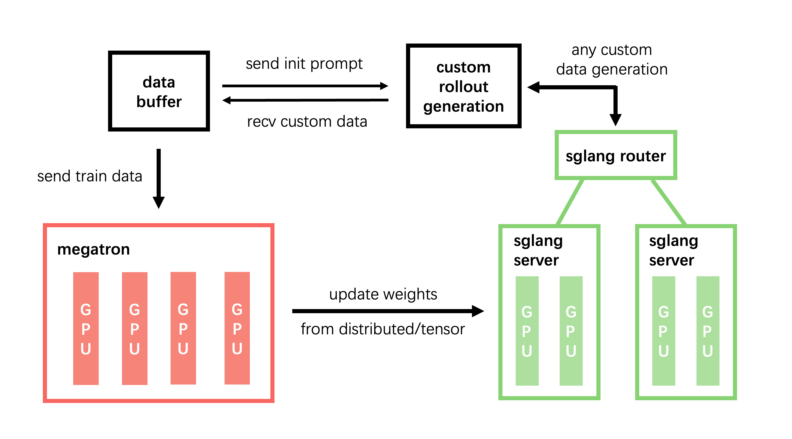

# slime

[English](./README.md)

[](https://thudm.github.io/slime/)
[](https://github.com/THUDM/slime/actions/workflows/pr-test.yml)
[![DeepWiki](https://img.shields.io/badge/DeepWiki-THUDM%2Fslime-blue.svg?logo=)](https://deepwiki.com/THUDM/slime)
<!-- DeepWiki badge generated by https://deepwiki.ryoppippi.com/ -->

**slime** 是为 RL scaling 设计的 LLM 训练框架，提供两大核心能力：

1. **高性能训练**：通过连接 Megatron 与 SGLang，支持各种模式的高效训练；
2. **灵活的数据生成**：通过自定义数据生成接口以及 server-based engine，实现任意训练数据生成流程。

slime 的设计目标，是让这两大能力彼此强化，同时避免把系统变成一组割裂的 trainer、rollout service 和 agent framework。Megatron training、SGLang rollout、custom data generation、reward computation、verifier feedback 和 environment interaction 都流经同一条 training / rollout / Data Buffer 路径。

这让 slime 成为最经受实战验证的开源 RL post-training 框架之一：它足够轻量、清晰、易扩展，同时也经过了 SOTA 级模型发布背后的完整训练闭环验证。

## 设计特点

- **生产实践**：slime 是 [GLM-5.3-Flash](https://z.ai/blog/glm-5.3-flash)、[GLM-5.3](https://z.ai/blog/glm-5.3)、[GLM-5.2](https://z.ai/blog/glm-5.2)、[GLM-5.1](https://z.ai/blog/glm-5.1)、[GLM-5](https://z.ai/blog/glm-5)、[GLM-4.7](https://z.ai/blog/glm-4.7)、[GLM-4.6](https://z.ai/blog/glm-4.6)、[GLM-4.5](https://z.ai/blog/glm-4.5) 背后的 RL 训练框架。
- **原生引擎集成**：直接使用 Megatron 参数，通过 `--sglang-` 前缀传入 SGLang 参数。
- **灵活的数据生成**：通过自定义接口接入生成函数、奖励函数、验证器和交互环境。
- **正确性与可靠性**：支持独立的 rollout 和训练调试、可复现性配置、故障恢复及 CPU/GPU 测试，服务长时间运行的实验。

## 支持的模型

除 GLM 系列外，slime 还支持 Qwen（Qwen3.8、Qwen3.6、Qwen3.5、Qwen3-Next、Qwen3 MoE、Qwen3、Qwen2.5）、DeepSeek（V3、V3.1、R1）和 Llama 3。模型配置见 [scripts/models](scripts/models/)，训练示例见[在线文档](https://thudm.github.io/slime/zh/)。

## 引擎配置与部署

可以直接使用 Megatron 的并行、优化器、checkpoint 和模型参数。当前安装版本的 SGLang 参数加上 `--sglang-` 前缀即可传入，例如将 `--mem-fraction-static` 写成 `--sglang-mem-fraction-static`。

复杂部署可参考：

- [SGLang 配置](docs/zh/advanced/sglang-config.md)：通过 YAML 配置服务器组、多模型服务和每组独立参数。
- [PD 分离](docs/zh/advanced/pd-disaggregation.md)：分开配置 prefill 和 decode 资源。
- [增量权重同步](docs/zh/advanced/delta-weight-sync.md)：通过共享存储传输发生变化的权重字节。
- [外部 rollout 引擎](docs/zh/advanced/external-rollout-engines.md)：接入训练任务之外管理的推理进程，并支持通过磁盘在不同 GPU 集群之间更新权重。

## 正确性、稳定性与 CI

CPU 测试覆盖核心行为和自定义接口约定；GPU 测试覆盖 dense/MoE 训练、rollout 部署、checkpoint、精度、全异步 rollout、蒸馏和调试回放。测试矩阵与运行方法见 [CI 指南](docs/zh/developer_guide/ci.md)。

相关工程文档：[调试](docs/zh/developer_guide/debug.md)、[可复现性](docs/zh/advanced/reproducibility.md)、[故障恢复](docs/zh/advanced/fault-tolerance.md)、[调用追踪](docs/zh/developer_guide/trace.md)和[性能分析](docs/zh/developer_guide/profiling.md)。

## 博文

- [slime：为 RL Scaling 设计的 SGLang-Native 后训练框架](https://thudm.github.io/slime/zh/blogs/introducing_slime.html)
- [Agent-Oriented Design: An Asynchronous and Decoupled Framework for Agentic RL](https://www.notion.so/Agent-Oriented-Design-An-Asynchronous-and-Decoupled-Framework-for-Agentic-RL-2278e692d081802cbdd5d37cef76a547)
- [slime v0.1.0：重新定义高性能 RL 训练框架](https://thudm.github.io/slime/zh/blogs/release_v0.1.0.html)

## 目录

- [架构总览](#架构总览)
- [快速开始](#快速开始)
- [基于 slime 构建的生态](#基于-slime-构建的生态)
- [参数说明](#参数说明)
- [代码阅读路线](#代码阅读路线)
- [开发指南](#开发指南)
- [常见 Q&A 与致谢](#常见-qa-与致谢)

## 架构总览



**模块说明**：

- **training (Megatron)**：负责主训练流程，从 Data Buffer 读取数据，训练完后将参数同步至 rollout 模块；
- **rollout (SGLang + router)**：生成新数据（含 reward/verifier），存储至 Data Buffer；通过 custom generate 可以在其上叠加 multi-turn loop、tool call、environment/sandbox 交互以及 verifier-based reward；
- **data buffer**：桥梁模块，管理 prompt 初始化、自定义数据与 rollout 生成方法（包括以同一套接口产出 sample 的 agentic workflow）。

默认通过 Ray `object-store` 传输数据。选择 `--rollout-data-transport straw` 后，通过 [straw](https://github.com/zhuzilin/straw) 在 JuiceFS 共享存储上持久化 提示任务、rollout 续生成状态和训练批次。Ray 传递控制消息和引用，生成与训练进程直接并行读写数据。详见 [straw 使用与恢复指南](docs/zh/advanced/straw.md)。

## 快速开始

有关环境配置、数据准备、训练启动和关键代码分析的完整快速开始指南，请参考：

- [快速开始指南](./docs/zh/get_started/quick_start.md)

我们还提供了一些未在快速开始中覆盖的使用示例，请查看 [examples](examples/)。

### Agentic RL 示例

以下智能体训练示例通过自定义接口接入标准的 rollout 和数据缓冲区：

- [`examples/multi_agent`](examples/multi_agent/README.md)：在标准 rollout 循环内通过 `--custom-generate-function-path` 实现多智能体生成。
- [`examples/search-r1`](examples/search-r1/)：通过 `--custom-generate-function-path` 实现搜索/RAG 风格的多轮生成。
- [`examples/fully_async`](examples/fully_async/README.md)：全异步 rollout，适合样本生成耗时差异较大的长尾任务。
- [`examples/coding_agent_rl`](examples/coding_agent_rl/README.md)：使用 Qwen3.8-27B、小米 MiMo SWE 数据和 sunabako 沙盒，运行代码智能体 RL，保留官方测试奖励和 token 级训练轨迹。

如何为智能体工作流选择合适的接口，请参考 [自定义指南](docs/zh/get_started/customization.md)。

## 基于 slime 构建的生态

这些项目不只是 demo。它们是把 slime 作为可复用 RL substrate 的独立系统，覆盖生产级 post-training、agentic RL、domain RL 和 rollout-system research。

### 🐎 Dressage：面向任意 Agent 与 Sandbox 的可扩展 RL

[**Dressage**](https://github.com/Accio-Lab/Dressage) 是 [Alibaba Accio](https://www.accio.com/work?im_ref=1O8wgT3poxyZWCj31F1ZJ0fNUkuTK6x9ZTHw0Y0&sharedid=&im_pid=5619512&im_pname=AI%20INTRO%20COPORATE) 基于 slime 构建的 agentic RL training framework，面向 blackbox agents（例如 [OpenCode](https://github.com/anomalyco/opencode)、[OpenClaw](https://github.com/openclaw/openclaw)）以及任意 sandbox environment（例如 [bwrap](https://github.com/containers/bubblewrap)、[E2B](https://github.com/e2b-dev/e2b)、Kubernetes）提供统一 RL。它通过 Paddock、Sandbox 和 Proxy 层解耦交互语义、执行位置与 token-level trajectory capture，在不重写 agent 内部循环的情况下适配 agent workflow。Dressage 会记录 token-wise logprobs、loss masks、weight versions 和 MoE routing，并使用 TITO 与 segment-aware training 将长程 tool interaction 转换为稳定的 RL samples。

### ⛵ Miles：面向大规模模型训练的企业级强化学习框架

[Miles](https://github.com/radixark/miles) 是 [RadixArk](https://github.com/radixark) 基于 slime 构建的大模型 RL 后训练框架。它与 slime 上游开发保持紧密同步，同时在此基础上针对企业场景做了一系列扩展：更深度的 [SGLang](https://github.com/sgl-project/sglang) 集成、配套的运维与部署工具和服务，以及针对[新模型](https://www.radixark.com/miles/docs/models)和[新硬件](https://www.radixark.com/miles/docs/platforms)的优化。Miles 也在持续围绕真实生产环境需求迭代和进化，例如加入对 LoRA、TITO、低精度训练的支持。

### 🔷 vime: 基于 slime 的 vLLM-Native RL Post-Training 框架

[**vime**](https://github.com/vllm-project/vime) 是由 vLLM 项目维护的、基于 slime 的后训练框架。它保留 slime 的 Megatron 训练栈、Data Buffer 数据流与自定义 data generation 设计，主要特点是将 rollout 后端替换为 [**vLLM**](https://github.com/vllm-project/vllm)（配合 [vllm-router](https://github.com/vllm-project/router)）。在现有 slime 启动脚本基础上仅调整 rollout 相关参数，即可快速适配 vime 进行训练。

### 🌈 Relax: Asynchronous RL Engine for Omni-Modal Agentic Training

[**Relax**](https://github.com/redai-infra/Relax) (Reinforcement Engine Leveraging Agentic X-modality) 是 RedAI Infra 团队开源的 omni-modal agentic RL framework，构建在结合 Ray、Megatron-LM 和 SGLang 的 slime infrastructure stack 之上。Relax 采用 Ray Serve 上的 service-oriented architecture，以 Megatron-LM 和 SGLang 作为 training/inference backend。它使用 [TransferQueue](https://github.com/Ascend/TransferQueue) 将 Actor、Rollout、ActorFwd、Reference 和 Advantage computation 完全解耦到独立 GPU 集群，并引入 **DCS (Distributed Checkpoint Service)**，通过 NCCL-broadcast weight-sync engine 将更新后的 Actor 权重异步 stream 到 Rollout/ActorFwd/Reference，并与下一步训练重叠，从而在可配置 staleness 下实现 fully-async training。Relax 支持 text、vision、audio（包括 Qwen3-Omni）以及 agentic multi-turn rollout 的端到端 RL。

### 🦞 OpenClaw-RL: Train a Personalized Clawbot Simply by Talking to It

[**OpenClaw-RL**](https://github.com/Gen-Verse/OpenClaw-RL) 是面向 personalized OpenClaw agent 的 RL server。它托管 OpenClaw model，并从跨部署的历史对话中持续改进模型，同时 slime 的 decoupled RL infrastructure 避免训练过程干扰 API serving。它支持两种自动优化方法：基于后续状态推断 binary feedback 的 GRPO，以及从后续反馈中提取 hindsight hint 的 on-policy distillation。

### ⚛️ P1: Mastering Physics Olympiads with Reinforcement Learning

[**P1**](https://prime-rl.github.io/P1/) 是一系列完全通过 reinforcement learning 训练的开源物理推理模型。P1 使用 slime 作为 RL post-training framework，并提出 multi-stage RL training algorithm，通过 adaptive learnability adjustment 和 stabilization mechanism 逐步增强推理能力。在这一训练范式下，P1 在开源物理推理上取得了突破性表现。

### 📈RLVE: Scaling LM RL with Adaptive Verifiable Environments

[**RLVE**](https://github.com/Zhiyuan-Zeng/RLVE) 提出使用 verifiable environments 来扩展语言模型 RL：环境以程序化方式生成问题，并提供可算法验证的 reward。通过在 400 个 verifiable environment 上联合训练，RLVE 能让每个 environment 随训练进展动态适配 problem difficulty distribution，使其匹配当前 policy model 的能力。

### ⚡ TritonForge: Agentic RL Training Framework for Kernel Generation

[**TritonForge**](https://github.com/RLsys-Foundation/TritonForge) 使用 slime 的 SFT 和 RL 能力训练能够自动生成优化 GPU kernel 的 LLM。通过 supervised fine-tuning 加 reinforcement learning with multi-turn compilation feedback 的两阶段训练，TritonForge 在将 PyTorch operation 转换为高性能 Triton kernel 上取得了显著结果。

### 🚀 APRIL: Accelerating RL Training with Active Partial Rollouts

[**APRIL**](https://github.com/RLsys-Foundation/APRIL) 提出一种可以无缝集成到 slime 的 system-level optimization，用于加速 RL 训练中的 rollout generation 阶段。它通过智能 over-provision request 并主动管理 partial completion，缓解 rollout 生成中常见的 long-tail bottleneck，而这一阶段通常会消耗 RL 训练 90% 以上的时间。

### 🏟️ qqr: Scaling Open-Ended Agents with ArenaRL & MCP

[**qqr**](https://github.com/Alibaba-NLP/qqr) (a.k.a. hilichurl) 是一个用于演化 open-ended agent 的 slime lightweight extension。它实现 **ArenaRL** algorithm，通过 tournament-based relative ranking（例如 Seeded Single-Elimination、Round-Robin）缓解 discriminative collapse，并无缝集成 **Model Context Protocol (MCP)**。qqr 利用 slime 的高吞吐训练能力，在标准化、解耦的 tool environment 中实现可扩展的分布式 agent evolution。

### ☁️ ART: Scalable and Sandboxed Agentic RL on AWS Bedrock AgentCore Runtime

[**ART (AgentCore RL Toolkit)**](https://github.com/awslabs/agentcore-rl-toolkit) 是一个能够将真实生产环境中的 agent 适配到 **AWS Bedrock AgentCore Runtime** 上进行 RL 训练的工具包。AgentCore Runtime 提供了能够自动扩展以及沙盒式封闭管理的智能体运行环境，这非常适合安全地并行运行大量 agent rollouts。利用 ART，用户只需在 agent 代码上使用一个 decorator（`@app.rollout_entrypoint`），即可在直接复用生产环境的 agent harness 基础上完成 RL 训练的适配，其中用于 RL 训练的 token capture 则在 model gateway layer 中完成。ART 将 slime 列为 RL 训练的后端选项之一，帮助用户能够轻松地使用 slime 中的 RL 训练算法优化生产环境上的 agent 模型。

这些项目共同体现了 slime 的核心思路：一个高性能 RL kernel 可以同时支撑 frontier model post-training、online agent optimization、verifiable environment、omni-modal rollout、kernel-generation agent 和 rollout-system research，而不需要改变核心 training loop。

## 参数说明

参数分为三类：

1. **Megatron 参数**：slime 会直接读取 Megatron 参数，可以通过传入如 `--tensor-model-parallel-size 2` 的方式配置 Megatron；
2. **SGLang 参数**：支持当前环境中安装版本 SGLang 的所有参数，这些参数需要以 `--sglang-` 起始，例如 `--mem-fraction-static` 需要通过 `--sglang-mem-fraction-static` 传入。
3. **slime 自身的参数**：请见：[slime/utils/arguments.py](slime/utils/arguments.py)

完整使用说明请查阅 [使用文档](docs/zh/get_started/usage.md)。

## 代码阅读路线

建议从训练主循环出发，再按需求逐层追踪：

```text
train.py: train
├─ slime/ray/placement_group.py       Ray 资源和 worker 初始化
├─ slime/ray/rollout.py              RolloutManager.generate：rollout 编排
│  └─ slime/rollout/sglang_rollout.py  Sample 生成和 reward 计算
└─ slime/ray/actor_group.py          RayTrainGroup.async_train：调度训练
   └─ slime/backends/megatron_utils/actor.py
      ├─ model.py                    Megatron 模型执行
      └─ loss.py                     RL loss 和 advantage 计算
```

首次阅读时，可以先把 `slime/utils/arguments.py` 当作配置入口。`slime/backends/sglang_utils/` 里的部署细节，以及 `slime/backends/megatron_utils/update_weight/` 里的权重同步实现，也可以等需要修改对应功能时再读。

## 开发指南

- 提交 Issue 或 PR 前，请先阅读[贡献指南](CONTRIBUTING.md#开源协作范围说明)。

- 使用 [pre-commit](https://pre-commit.com/) 保证提交代码风格：

  ```bash
  apt install pre-commit -y
  pre-commit install

  # 运行 pre-commit 保证代码风格
  pre-commit run --all-files --show-diff-on-failure --color=always
  ```

- 调试技巧请参考 [调试指南](docs/zh/developer_guide/debug.md)

## 常见 Q&A 与致谢

- 常见问题请见 [Q&A](docs/zh/get_started/qa.md)
- 特别感谢以下项目 & 社区：SGLang、Megatron‑LM、mbridge、OpenRLHF、veRL、Pai-Megatron-Patch 等。

- 引用 slime 请使用：
```bibtex
@misc{slime_github,
  author       = {Zilin Zhu and Chengxing Xie and Xin Lv and slime Contributors},
  title        = {slime: An LLM post-training framework for RL Scaling},
  year         = {2025},
  howpublished = {\url{https://github.com/THUDM/slime}},
  note         = {GitHub repository. Corresponding author: Xin Lv},
  urldate      = {2025-06-19}
}
```
