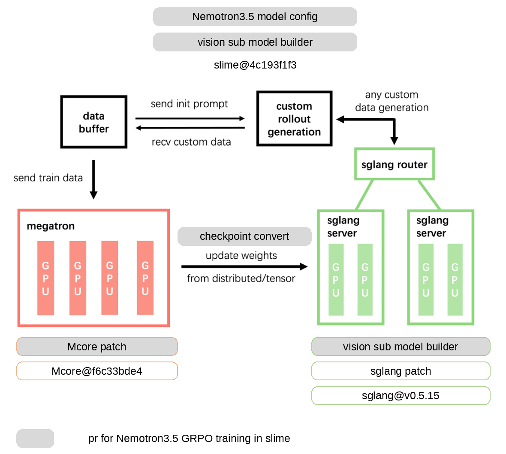

# Nemotron 3.5 Super VL: GRPO on GEO3K

Support for `nvidia/NVIDIA-Nemotron-3.5-Super` on slime's Megatron backend with a colocated
SGLang rollout. This document describes the design, what the change implements,
the implementation details that are easy to get wrong, and how the change was
tested (unit tests and end-to-end validation), including how to reproduce the results.

---

## 1. Design

<p align="center">
  
</p>

The picture is slime's RL loop (data buffer, custom rollout generation, a
Megatron training group, and an SGLang router with its servers, joined by the
weight update). Grey boxes are what this PR adds or changes; white boxes are the
pinned upstream versions it is built against (slime at its base commit, MCore
`ae76c60e6` on NVIDIA/Megatron-LM `dev`, SGLang `v0.5.15`).

The change is shaped by six rules.

**1. Reuse the reference implementation; do not re-implement the model.**
The decoder is MCore's own `HybridModel` (it already has Mamba2, latent-space
MoE, squared-ReLU experts and MTP); the plugin only translates configuration and
selects the stack. The vision tower and projector are instantiated from the
checkpoint's own remote code (`modeling_radio.RadioModel`,
`NemotronH_Omni_Reasoning_V3VisionProjector`), the same idiom `qwen3_5_vl.py` uses
for its ViT. Their semantics (a LayerNorm whose presence depends on the LLM
having MTP layers, the pixel-shuffle version flag, the `mlp1` activation) then
come for free and cannot drift. The model config file for 3.5 sources the
Nemotron 3 one instead of copying it, because the two language configs are
identical.

**2. The trainer and the rollout engine must be the same model.**
Every modelling decision was settled against SGLang's implementation and the
checkpoint, not against what looks natural for Megatron: NoPE attention, sigmoid
router with expert bias, non-gated experts, one MTP depth. A mismatch does not
raise; it shows up as `train_rollout_logprob_abs_diff` far above 0.1. That metric
is the integration oracle for the whole change.

**3. The weight sync is half of the model, and it is a pair.**
HF to Megatron (cold start) and Megatron to HF (every rollout) are written as
exact inverses and tested as round trips. The target of the export is the
released checkpoint's own key set, because SGLang routes weights by prefix and
silently drops a name it does not recognise. Names are therefore pinned to
checkpoint keys, not inferred.

**4. Fail loudly where the framework would stay silent.**
Wherever a wrong input produces the right shapes and no exception, the code adds
the exception: unknown parameters, a whole expert stack, an MTP depth the
checkpoint cannot hold, a token/feature count mismatch, a loss mask that cannot
be aligned, an optimizer-offload flag the Megatron in use does not have.

**5. Keep model-specific code in plugins and dispatchers; make shared-code
changes general.**
The model lives in `slime_plugins/` and in per-family converter modules selected
by name. Where the shared code assumed a GPT stack (routing replay, the gated
`linear_fc1` split, MTP expert naming, multimodal batch concatenation), the
change generalises it and keeps the old behaviour as the special case, with
tests.

**6. Version-pin the patches.**
Patches against MCore and SGLang are applied by the Dockerfile at fixed
commits, and `git apply --check` gates the build. Changes needed in those trees
live in the patch, not in a fork.

The VL forward, as implemented in `NemotronHVLModel`:

```
pixel_values (list when images differ in size)
   -> RADIO ViT-H (replicated across TP ranks, params marked non-TP)
   -> projector: LayerNorm -> pixel shuffle -> mlp1          (one image at a time)
   -> flatten each image to [tokens_i, hidden], concatenate
   -> scatter into the decoder embedding at every <image> token (full sequence,
      before sequence-parallel sharding)
   -> HybridModel(decoder_input=...): Mamba2 / MoE / attention (NoPE), MTP
```

---

## 2. What this PR implements

The model is an 88-layer hybrid decoder (40 Mamba2, 40 MoE, 8 attention layers;
512 routed experts at top-k 22 in a 1024-wide latent space; one shared expert;
one MTP layer) with a C-RADIO ViT-H vision tower and a pixel-shuffle + MLP
projector. Support required work in five places.

| Area | What was added or changed |
| --- | --- |
| **Model definition** | `slime_plugins/models/nemotron_h.py` (text) and `nemotron_h_vl.py` (VL): model providers that build MCore's own `HybridModel` as the decoder. The VL provider hangs the RADIO tower and the projector off it and scatters image features into the embedding at `<image>` positions. `scripts/models/nemotron3-super-120b-a12b.sh` and `nemotron3.5-super-vl.sh` carry the architecture flags (the VL file sources the text one and overrides only `--spec`). |
| **Checkpoint conversion** | `hf_to_megatron/nemotron_h{,_vl}.py` (cold start) and `megatron_to_hf/nemotron_h{,_vl}.py` (the weight sync that pushes trainer weights into SGLang before every rollout). Covers Mamba `in_proj`/`conv1d` TP layout, fused/grouped QKV, non-gated experts, the shared expert, the MTP layer, and the RADIO tower's renamed and fused weights. |
| **MCore and SGLang patches** | `docker/patch/latest/megatron.patch` (Megatron pinned to `ae76c60e6` in `docker/Dockerfile`) and the new `docker/patch/latest/sglang-nemotron_vl.patch`, which teaches SGLang to serve this architecture (including the Super-only `vision_final_layernorm`), run MTP speculative decoding for it, and capture routed experts for it. |
| **Training pipeline** | MTP training and logging; per-image handling of variable-resolution pixel inputs (`collate_multimodal_train_inputs`); image resizing that makes the trainer and the rollout engine see identical pixels (`process_vision_info`); SFT on VLM conversations (`sft_rollout.py`, loss-mask alignment); `total_tokens` for packed Mamba sequences; routing replay (R3) for hybrid stacks; the gated-MLP flag shared by the loader and the weight sync. |
| **Compatibility** | `slime_plugins/models/qwen3_5.py` and `qwen3_next.py` accept the kwargs current MCore passes to `self_attention`; `qwen3_5_vl.py` skips the CP index map when there is no CP; the MTP metrics tracker reads both the old and the current MCore layout; speculative-decoding counters read SGLang's current key names. |
| **Example** | `examples/geo3k_vlm/run_geo3k_nemotron35.sh`: GRPO, TP2 / EP32 / PP1 / CP2, DeepEP dispatch, 4 nodes, MTP on by default. Every other training hyperparameter is `run_geo3k_qwen35.sh`'s. |

What it does **not** do: MTP training together with routing replay (rejected with a
clear error, see §3.7). This is not specific to Nemotron: SGLang records routed
experts for the target model only, so it applies to any model whose MTP layers
contain MoE routers.

---

## 3. Implementation details worth knowing

Each item is a place where the obvious implementation is wrong without raising.

### 3.1 Architecture flags

- **Attention is NoPE.** `config.json` still carries `rope_theta` and
  `partial_rotary_factor`, but neither SGLang's `nemotron_h.py` nor the
  checkpoint's modeling code applies any position embedding. Configuring RoPE
  makes the trainer a different model from the engine (`train_rollout_logprob_abs_diff`
  2.3 against a 0.1 bound, `entropy_loss` 0.75 against 0.16). Use
  `--position-embedding-type none`.
- **Router and experts follow the engine, not Megatron defaults.** The router scores
  with sigmoid plus a learned expert bias (the checkpoint carries
  `e_score_correction_bias`, SGLang uses `scoring_func="sigmoid"`, and MCore
  rejects an expert bias with any other score function). Experts are not gated:
  squared ReLU, `up_proj`/`down_proj` only, so `linear_fc1` is `up_proj` alone
  and there is no `w13` layout to match (which is why the Qwen recipe's
  `--sglang-moe-runner-backend triton` pin is not carried over). They run in a
  1024-wide latent space through `fc1_latent_proj` / `fc2_latent_proj`, which MCore
  names exactly as the checkpoint does.
- **Pass `--hybrid-override-pattern` quoted.** It is an 88-character string
  containing `*`. An unquoted shell expansion is subject to pathname
  expansion, and a matching file in the working directory silently replaces the
  value, building a different architecture with nothing in the log.

### 3.2 Weight mapping

- **Ask the model whether `linear_fc1` is gated; do not infer it.** Only a gated
  `linear_fc1` is `cat(gate, up)` and needs the interleaved TP shard. Neither the
  parameter name nor `partition_stride` can tell (a gated grouped expert reports
  stride 1). `has_gated_linear_unit(args)` is the one source of truth, and the
  load-time shard and the weight-sync gather must both use it. Loading wrongly
  and gathering wrongly cancel for an ungated model, so correcting only one half
  permutes rows while keeping every shape (measured: eval score 0.0, all
  responses truncated).
- **Mamba `in_proj` and `conv1d` need a TP-aware layout.** `in_proj` packs
  `[z, x, B, C, dt]` and `conv1d` packs `[x, B, C]`, each component sharded
  independently. slime's loader shards with a plain chunk, so the loader builds
  `[z_0, x_0, ..., z_1, x_1, ...]` and the exporter de-interleaves. At TP1 both
  are the identity, so a TP1 run cannot expose a mistake; the tests cover TP2.
  MCore also registers `conv1d` as the flat `conv1d_weight` / `conv1d_bias`,
  while HF has a real `nn.Conv1d`.
- **Several MCore names map to one HF name, and the grouping differs.** The
  pre-mixer norm is folded into `in_proj` (Mamba) or `linear_qkv` (attention) and
  kept as `pre_mlp_layernorm` (MoE); all three map to
  `backbone.layers.{i}.norm.weight`. MCore's `linear_qkv` is laid out per KV
  group, not `[q | k | v]`. The VL decoder keeps a `language_model.` prefix on
  the HF side, and VL model names (`nemotron_h_omni`, or the config class name
  slime passes when `--model-name` is unset) must be routed to the VL exporter
  before the text one, since they also contain `nemotron`.
- **The RADIO tower's module tree is not the released checkpoint's.** The weights
  are timm-style C-RADIO (`radio_model.model.blocks.N.attn.qkv`, fused), while
  `RadioModel` is `embeddings.*` / `encoder.layer.*` with separate q/k/v. The
  converters apply the registered rename mapping, inverted for export, and the
  exporter buffers q/k/v (per block, weight and bias separately) until the
  fused tensor can be emitted. The tower and projector are replicated across TP
  ranks, so their parameters are marked non-tensor-parallel to keep the
  exporter from all-gathering them. A check that enumerates checkpoint keys
  proves nothing, since it maps keys to themselves; enumerate the model's own
  parameter names.
- **Hybrid MTP experts need their EP offset too.** In a hybrid MTP layer the
  expert names sit under `mtp_model_layer.layers.{k}.mlp.experts.` rather than
  `transformer_layer.mlp.experts.`. If the offset regex does not match, every
  EP rank publishes its local experts under the same names 0..n_local-1 and the
  draft model silently loads wrong experts.

### 3.3 Vision path

- **C-RADIO's no-op LayerScale and the Super-only LayerNorm are two halves of a
  pair with SGLang.** C-RADIO has no layerscale (`layerscale_value` is 1.0), but
  `RadioLayer` builds one unconditionally; keeping it adds 64 parameter names no
  checkpoint writes and a constant the optimizer would move. The trainer
  replaces the modules with `nn.Identity` and the SGLang patch does not create
  the parameters. Conversely the projector's `vision_final_layernorm` (present
  because the LLM has MTP layers) must be loaded by SGLang: its `load_weights`
  routes by prefix with no `else`, so without the patch the two tensors are
  dropped and image embeddings are quietly wrong.
- **Inject vision features on the full sequence.** The `<image>` mask is built
  from the full packed sequence, so the embedding must not shard it first
  (`IndexError: mask [2304] vs tensor [1152, 4096]` at TP2); the provider passes
  `scatter_embedding_sequence_parallel=False` and scatters once at the end of
  injection. Without CP, skip the CP index map: `get_packed_cp_local_indices`
  requires each packed length to divide by `2 * cp_size`, which at CP1 means
  "must be even" and rejects odd lengths.
- **Run the projector per image, and keep pixel inputs that do not concatenate as
  a list.** The processor is variable-resolution, and the reference projector
  concatenates per-image outputs along dim 0, which needs equal token counts.
  Flatten each image to `[tokens_i, hidden]` first (bit-identical for equal
  resolutions). `collate_multimodal_train_inputs` likewise concatenates a key
  only if every dimension except dim 0 agrees (Qwen's ragged patches do;
  Nemotron's `(tiles, 3, H, W)` does not).
- **Resize once, to the processor's own target size.** HF rounds patches with
  `round(x + 0.5)` and SGLang with `round(x)`; on GEO3K that gives different
  image-token counts for 1570 of 2702 images. The HF target size is a fixed
  point of both rules, so resizing to it first makes both sides build the same
  grid and the same pixels. The check is an integration test over all of GEO3K.

### 3.4 MTP

- **Training side: one checkpoint depth, applied repeatedly.** Megatron builds the
  layer once (`--mtp-use-repeated-layer`), so the layer pattern needs one `/*E`
  segment per depth, only the main stack counts towards `--num-layers`, and the
  exporter rejects depth > 0 (distinct per-depth weights would all land on the
  same names). slime asks for the MTP loss the GPTModel way; `HybridModel` takes
  `compute_mtp_loss` instead, which defaults to true, so `mtp_kwargs` is
  translated (dropping it alone would train the MTP layers with MTP training
  off). The MTP branch also needs `position_ids`, which slime never passes
  because the main stack is NoPE, so they are generated per packed sequence.
- **Draft side: three silent failures.** MCore's MTP is fed `embedding(input_ids)`,
  not the injected `decoder_input`, so SGLang's draft maps multimodal pad ids
  back to `<image>`, otherwise they index past the vocabulary. The draft loader
  must strip `language_model.` from `mtp.*`, otherwise every MTP tensor is
  skipped and the draft runs on uninitialised weights. And the counters must be
  read under SGLang's current names (`spec_num_correct_drafts` /
  `spec_num_proposed_drafts`), or `spec_accept_rate` stays 0.0 while
  `spec_accept_length` looks fine. The acceptance rate (about 0.87 when
  correct, near 0 when wrong) is the only end-to-end signal. MCore's MTP
  tracker layout also changed (`values` to `loss_values` plus per-depth
  counts); both layouts are read.

### 3.5 Mamba and packing

- **Pass `total_tokens` in `PackedSeqParams`.** It is what makes MCore derive
  `seq_idx`, which Mamba's conv1d and SSM scan use to reset their state at
  sequence boundaries. Without it every sample after the first in a packed
  micro-batch inherits the previous sample's state. Attention and SGLang are
  unaffected, so the error is training-side only; `ppo_kl` cannot see it, only
  the comparison with the rollout can. The recipe does not pack (micro-batch 1)
  so it was never affected, but any Mamba model with `--use-dynamic-batch-size`
  or micro-batch > 1 was.

### 3.6 SFT on VLM data

- **A tokenizer renders `<image>` once; only the processor expands it** to the
  number of tokens the encoder emits and produces `pixel_values`, so
  `sft_rollout` runs the processor when a sample carries images. The text-only
  loss mask is then aligned by leading-zero padding, which is only correct if
  every modality token precedes the first supervised token; an image in a second
  user turn would slide the mask onto image pads and miss the first reply, so
  the alignment checks itself and raises.

### 3.7 Routing replay (R3)

- **Do not derive MoE layers from `moe_layer_freq` in a hybrid stack.** It
  describes GPT stacks and would mark all 88 layers as MoE. The trainer walks
  the actual `TopKRouter` modules and indexes the capture by each router's
  `layer_number`; the validator reads the `E` positions of the pattern; SGLang's
  `TopK` needs `layer_id`, otherwise the capture write becomes
  `buffer[:n, None, :]` and CUDA-graph capture fails. R3 and MTP training are
  mutually exclusive (SGLang captures routing for the target model only, so the
  MTP layers' routers have nothing to replay). This limitation is not specific
  to Nemotron: it holds for any model whose MTP layers contain MoE routers.
  slime now says so instead of failing an assertion.

### 3.8 Running it

- **Environment requirements that fail silently or late.** `mamba-ssm` and
  `causal-conv1d` are required by MCore's `MambaMixer` and are not in the slime
  image (the example script installs them). The optimizer-offload flag is
  version-dependent: `--offload-optimizer-states` is MCore 0.16's, 0.20 replaced
  it with `--optimizer-cpu-offload --use-precision-aware-optimizer`, and slime's
  `ignore_unknown_args=True` drops the wrong spelling silently so the run later
  fails on an 80 GB GPU; the script resolves it from the Megatron it finds. Recent
  `dev` declares both spellings, and there `--offload-optimizer-states` is a
  different mechanism (RL-time offload, not CPU-resident Adam), so the script
  checks `--optimizer-cpu-offload` first. Resuming from a checkpoint also needs
  `nvidia-resiliency-ext` on `dev` (cached checkpoint metadata); the Dockerfile
  installs it.
  EP x ETP must divide the world and 512 experts want EP32 (32 GPUs), so
  multi-node needs an external Ray cluster. For timing use rollout 1, not
  rollout 0 (autotune and the first weight sync), and do not carry the Qwen
  recipe's eval-0 reward band over: a near-zero eval 0 with median response
  length at the 4096 cap is truncation, not capability.

---

## 4. Testing

### 4.1 Unit tests

| File | Covers |
| --- | --- |
| `tests/test_nemotron_h_conversion.py` | Text converter, both directions, on a tiny synthetic config: Mamba `in_proj`/`conv1d` TP interleave round trip at TP1 and TP2 and the per-rank layout, grouped QKV, the three names that reach the one HF pre-mixer norm, non-gated experts and shared expert, router and latent projections, MTP layer names, tied embeddings, and every error path (whole expert stack, layer past the pattern, MTP depth > 0, missing MTP segment). |
| `tests/test_nemotron_h_vl_conversion.py` | VL converter, both directions: every RADIO name against the released checkpoint's key, fused-QKV split and re-fusion (any arrival order, weight vs. bias, no cross-block mixing), projector `mlp1.*` indices, the decoder prefix, `layers_block_type` to pattern derivation without mutating the shared config, and the `_convert_to_hf_core` dispatch (VL names never reach the text converter). |
| `tests/test_megatron_utils_misc.py` | `has_gated_linear_unit`; load-time shard vs. weight-sync gather are exact inverses for gated and ungated `linear_fc1` (and that fixing only one half permutes rows); `collate_multimodal_train_inputs` for ragged patches, differently sized images, single sample and `None` entries. |
| `tests/test_nemotron_h_vl_plugin.py` | Provider validation, hybrid-pattern resolution (CLI, nested config, `layers_block_type`, MTP suffix, length mismatch), packed MTP position ids, and the vision-embedding scatter with images of different token counts. Needs MCore >= 0.20 (`megatron.core.models.hybrid`); skipped otherwise. |
| `tests/test_hf_to_megatron.py`, `test_qwen3_5_vl_native.py` | Loader registry now lists `nemotron_h` / `nemotron_h_omni`; gated and ungated `linear_fc1` sharding. |
| `tests/test_rollout_data_utils.py` | R3 validation in a hybrid stack checks only the `E` layers (needs MCore >= 0.20). |
| `tests/test_sample.py` | Speculative-decoding counters read the current SGLang key names. |
| `tests/utils/test_multimodal_loss_mask_alignment.py` | SFT loss-mask alignment onto processor output, including the case that must raise. |
| `tests/test_process_vision_info_native_resize.py` | Native resize path vs. the Qwen path; an integration test over all of GEO3K (needs the dataset, the checkpoint and SGLang; skipped otherwise). |

```bash
pytest -m unit tests/test_nemotron_h_conversion.py tests/test_nemotron_h_vl_conversion.py \
    tests/test_megatron_utils_misc.py
pytest tests/test_hf_to_megatron.py tests/test_qwen3_5_vl_native.py tests/test_sample.py \
    tests/utils/test_multimodal_loss_mask_alignment.py tests/test_process_vision_info_native_resize.py
# need an MCore with megatron.core.models.hybrid (>= 0.20), i.e. the slime image:
pytest tests/test_nemotron_h_vl_plugin.py tests/test_rollout_data_utils.py
# the all-of-GEO3K image-size agreement check:
SLIME_TEST_GEO3K_DIR=/root/datasets/geo3k_imgurl \
SLIME_TEST_NEMOTRON_VL_CKPT=/root/models/NVIDIA-Nemotron-3.5-Super-EA-09112026 \
    pytest tests/test_process_vision_info_native_resize.py
```

The CPU-only files need no Megatron install; they mount the package the same way
`tests/test_hf_to_megatron.py` does.

### 4.2 End-to-end validation (4 nodes x 8 H100 80 GB, TP2 / EP32 / PP1)

The GRPO test cases in this section use `examples/geo3k_vlm/run_geo3k_nemotron35.sh` as the
reference script and only add environment variables to it. The two exceptions are the
HF log-prob comparison, which is an offline script over the dumped rollout data
(`hf_logprob_ref/`), and the
VLM SFT case, which uses `scripts/run-nemotron3.5-super-vl-sft.sh` (adapted from
`scripts/run-qwen3.5-35B-A3B-sft.sh`) as its
reference script. All numbers below were measured on Megatron `dev` `ae76c60e6` with the script defaults
(CP2, DeepEP and MTP training on) unless a row says otherwise.

The primary check is `train_rollout_logprob_abs_diff`: the mean absolute
difference between the log-prob Megatron's forward assigns to a rolled-out token
and the one SGLang recorded while generating it. It is zero only if the trainer
and the engine are the same model **and** the weight sync is exact. slime's CI
bounds it at 0.1; the Qwen3.5-35B-A3B recipe sits at about 0.0135.

Hyperparameters throughout: GRPO, lr 1e-6, rollout batch 64 x 8 samples = global
batch 512 (so one optimizer step per rollout), micro-batch 1, full recompute.
Short runs below use `SLIME_SCRIPT_NUM_ROLLOUT=2..4`; the long run uses the
script's defaults.

| Test case | What it checks and how to reproduce | Result |
| --- | --- | --- |
| HF reference log-prob parity | **What it checks:**<br>SGLang rollout log-probs vs. an HF `transformers` teacher-forced reference, on 512 rollout samples and 601 eval samples, with Megatron as a third party<br>**How to reproduce:**<br>Dump the trainer's rollout data (`--dump-details`), then score it with HF and compare per token (`hf_logprob_ref/README.md`) | Mean per-token abs log-prob difference, SGLang-Megatron **0.0144**, SGLang-HF 0.0275, Megatron-HF 0.0275 (1113 HF-scored samples, pre-checks C1-C4 pass on all). HF is equidistant from both, so the gap is HF being a third implementation, not an SGLang-only error. No drift along the response (0.038 to 0.022 across fifths). |
| Trainer vs. rollout log-prob gap | **What it checks:**<br>`train_rollout_logprob_abs_diff` over the first weight syncs, with the MTP head trained and synced<br>**How to reproduce:**<br>`SLIME_SCRIPT_NUM_ROLLOUT=2` (default, `USE_MTP=1`) | `train_rollout_logprob_abs_diff` at step 0 **0.0144**, at step 1 0.0147 (step 1 uses the weights after one optimizer step and a second sync). The Qwen3.5-35B-A3B recipe sits at about 0.0135. MTP acceptance rate 0.86 to 0.87 (accepted length 2.73 of 3). |
| Training forward vs. recompute | **What it checks:**<br>Training forward and the separate no-grad recompute agree<br>**How to reproduce:**<br>`SLIME_SCRIPT_EXTRA_ARGS='--lr 0 --get-mismatch-metrics --custom-tis-function-path slime.backends.megatron_utils.loss.vanilla_tis_function' SLIME_SCRIPT_NUM_ROLLOUT=4` | `ppo_kl` and `pg_clipfrac` exactly 0 with the recompute actually executed, so the two forwards are bitwise identical; mean TIS 1.0000 +/- 1e-4 (0.99994 to 1.00008 over the four steps). (Without `--get-mismatch-metrics` they are 0 by identity and prove nothing: slime reuses the training log-probs as the old ones.) |
| Weight-sync exactness (lr 0) | **What it checks:**<br>Weight sync is exact<br>**How to reproduce:**<br>Same command as the previous case (lr 0: weights never change, every sync pushes the same tensors) | `train_rollout_logprob_abs_diff` 0.0144 / 0.0150 / 0.0148 / 0.0147 at steps 0-3, i.e. after each of four syncs. No drift introduced by the sync, MTP head included. |
| Packed-sequence Mamba state | **What it checks:**<br>Packed Mamba sequences<br>**How to reproduce:**<br>`SLIME_SCRIPT_EXTRA_ARGS='--lr 0 --use-dynamic-batch-size --max-tokens-per-gpu 2048'`, compared against the unpacked run (`SLIME_SCRIPT_EXTRA_ARGS='--lr 0'`), both with `SLIME_SCRIPT_NUM_ROLLOUT=1` | `train_rollout_logprob_abs_diff` at step 0: 0.0144 unpacked (64 micro-batches per rank), **0.0145** packed (43 micro-batches per rank, i.e. about 1.5 samples packed together; the micro-batch counts were not recounted on `ae76c60e6`). `total_tokens` in `PackedSeqParams` (§3.5) keeps Mamba state from leaking between packed samples. A budget of 4608 tokens per GPU runs out of memory in the training step on 80 GB, also at CP1 with the native all-to-all dispatcher. |
| MoE routing replay (R3) | **What it checks:**<br>Training-side MoE routing taken from the top-k SGLang recorded, instead of recomputed<br>**How to reproduce:**<br>`USE_MTP=0 SLIME_SCRIPT_NUM_ROLLOUT=2 SLIME_SCRIPT_EXTRA_ARGS='--lr 0 --get-mismatch-metrics --custom-tis-function-path slime.backends.megatron_utils.loss.vanilla_tis_function --use-rollout-routing-replay'` | `train_rollout_logprob_abs_diff` at step 0 / step 1: 0.0141 / 0.0146 without R3, **0.0094 / 0.0097** with it. Routing disagreement accounts for about a third of the gap; the rest is kernel-level numerics. R3 needed three hybrid-stack fixes (§3.7). |
| Parallelism invariance | **What it checks:**<br>Different TP / EP splits give the same trainer-vs-rollout gap<br>**How to reproduce:**<br>Same as the weight-sync exactness case with `SLIME_SCRIPT_NUM_ROLLOUT=1` and `TENSOR_MODEL_PARALLEL_SIZE=4`, or `EXPERT_MODEL_PARALLEL_SIZE=16 EXPERT_TENSOR_PARALLEL_SIZE=2` (the script then uses the native all-to-all dispatcher, see below) | `train_rollout_logprob_abs_diff` at step 0: TP2/EP32 0.0144, TP4/EP32 0.0147, TP2/EP16/ETP2 0.0146 (CP2) and 0.0143 (CP1). Same within run-to-run noise: the TP split of attention, Mamba and the shared expert, and the expert offsets, are right. DeepEP's flex dispatcher does not work with expert-TP > 1 (every rank dies with CUDA "unspecified launch failure"), so the script switches to the native all-to-all whenever `EXPERT_TENSOR_PARALLEL_SIZE > 1`. |
| Checkpoint resume | **What it checks:**<br>Checkpoint resume, including the MTP head and CPU-offloaded optimizer state<br>**How to reproduce:**<br>Save after a short run (`--save <dir> --save-interval 2`, `SLIME_SCRIPT_NUM_ROLLOUT=2`); resume with `--load <dir> --use-checkpoint-opt_param-scheduler` (and no `--save`, or one with `--save-interval`) | `train_rollout_logprob_abs_diff` 0.0147 at the first step after resuming (the original run: 0.0143 / 0.0147 at steps 0 / 1); acceptance 0.87; `grad_norm` 0.260 (0.248 / 0.298). |
| Long-run training dynamics | **What it checks:**<br>Training dynamics over 48 rollouts, no R3<br>**How to reproduce:**<br>defaults, two consecutive segments resumed from a checkpoint (`SLIME_SCRIPT_NUM_ROLLOUT=24 SLIME_SCRIPT_EXTRA_ARGS="--save <dir> --save-interval 4"`, then `SLIME_SCRIPT_NUM_ROLLOUT=48 SLIME_SCRIPT_EXTRA_ARGS="--load <dir> --save <dir> --save-interval 4 --use-checkpoint-opt_param-scheduler"`) | `raw_reward` 0.50 (rollouts 0-9) to 0.72 (40-47); eval `geo3k_imgurl` **0.41 / 0.71 / 0.74** at rollouts 0 / 19 / 39 (single-eval noise is about +/- 0.03). Response length 2152 to 1228 tokens; truncation fell (0.16 to 0.05); `grad_norm` 0.105-0.264, apart from a single 0.31 on the first step after the checkpoint resume. `train_rollout_logprob_abs_diff` stayed 0.009-0.015 and tracks policy entropy (0.16 down to 0.08, correlation 0.96) rather than diverging. |
| VLM SFT | **What it checks:**<br>`sft_rollout` with the processor, same model<br>**How to reproduce:**<br>`SFT_NUM_ROLLOUT=47 scripts/run-nemotron3.5-super-vl-sft.sh` (4 nodes x 8 GPUs, TP2 / CP2 / EP32, DeepEP and MTP training on by default, `--debug-train-only`; one sample per micro-batch, no dynamic batching, like the GRPO script) | Trains and checkpoints: 47 steps, loss from 2.19 to 0.11 (8 micro-batches of one sample per rank and step). |
